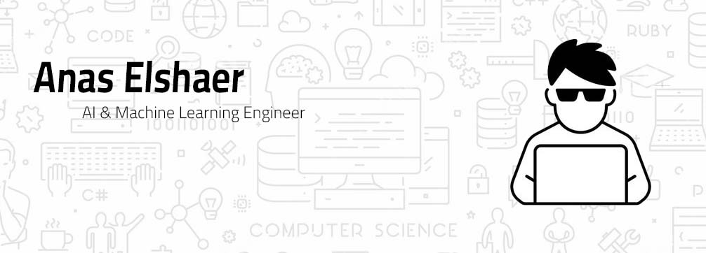

  

  <h1>Anas Elshaer</h1>

  <h3>Full-Stack AI Software Engineer</h3>

  

    I build software products from the ground up, with AI where it actually makes a difference.
  

  

    <a href="https://anaselshaer01.github.io/">Portfolio</a>
    &nbsp;·&nbsp;
    <a href="https://www.linkedin.com/in/anas-elshaer01/">LinkedIn</a>
    &nbsp;·&nbsp;
    <a href="https://github.com/AnasElshaer01">GitHub</a>
  

---

### A little about me

I'm a Full-Stack AI Software Engineer who enjoys working across the entire product, from figuring out what needs to be built to designing the architecture, writing the code, and getting it into production.

My work sits at the intersection of **software engineering, AI, and product development**.

That means I'm just as interested in designing a reliable backend or a clean user experience as I am in building an LLM pipeline, orchestrating AI agents, or connecting different systems together.

I've previously interned at **Dell Technologies** and worked in both startup and corporate environments.

These days, most of what I build falls into a few areas:

- **Full-stack products** — Interfaces, APIs, backend services, databases, and everything connecting them.
- **AI applications** — LLMs, RAG, agentic workflows, and practical AI integrations.
- **Automation** — Making separate tools, services, and business processes work together.
- **Infrastructure** — Taking applications beyond localhost with cloud deployments, containers, and CI/CD.

---

### The engineering side

The technologies I use depend on the problem, but this is the stack I regularly work with.

**Languages & Application Development**

  

**Data & Backend Architecture**

  

**Cloud & Delivery**

  

---

### Where AI fits in

I work with AI as part of the application architecture, not as a separate feature added at the end.

My focus is on connecting models with the data, tools, and backend systems they need to be useful.

| Area | What I work on |
|---|---|
| **LLM Engineering** | Model integration, fine-tuning, prompt and context engineering, function calling, structured outputs, and evaluation |
| **Agentic Systems** | Tool calling, multi-agent collaboration, stateful workflows, memory, and external API integrations |
| **RAG & Retrieval** | Document ingestion, parsing, chunking, embeddings, vector databases, semantic search, relevance filtering, reranking, and grounded generation |
| **AI Orchestration** | LangChain, LangGraph, and LlamaIndex for developing LLM applications, controlled agent workflows, and data-centric AI systems |

---

### Making systems work together

Not every problem needs a new application. Sometimes the better solution is connecting the systems that already exist.

I build workflows around APIs, webhooks, event-driven processes, and AI-powered automation, using tools like **n8n** and **Make** when they fit.

---

### What that looks like in practice

The kinds of systems I'm interested in building:

- **AI-powered SaaS platforms** that bring useful intelligence into everyday workflows.
- **Full-stack applications** with reliable backend services and scalable architectures.
- **Knowledge retrieval systems** that make private and domain-specific information easier to access.
- **AI agents** that retrieve context, use tools, coordinate tasks, and interact with external systems.
- **Data-driven applications** that help people explore information and make decisions without needing technical expertise.
- **Business automation systems** that reduce repetitive work through integrations and intelligent workflows.

---

### Find me elsewhere

I'm always interested in interesting engineering problems, product ideas, and conversations about building software.

**[Portfolio](https://anaselshaer01.github.io/)** · **[LinkedIn](https://www.linkedin.com/in/anas-elshaer01/)** · **[GitHub](https://github.com/AnasElshaer01)** · **[X / Twitter](https://twitter.com/anas_ai1)**
